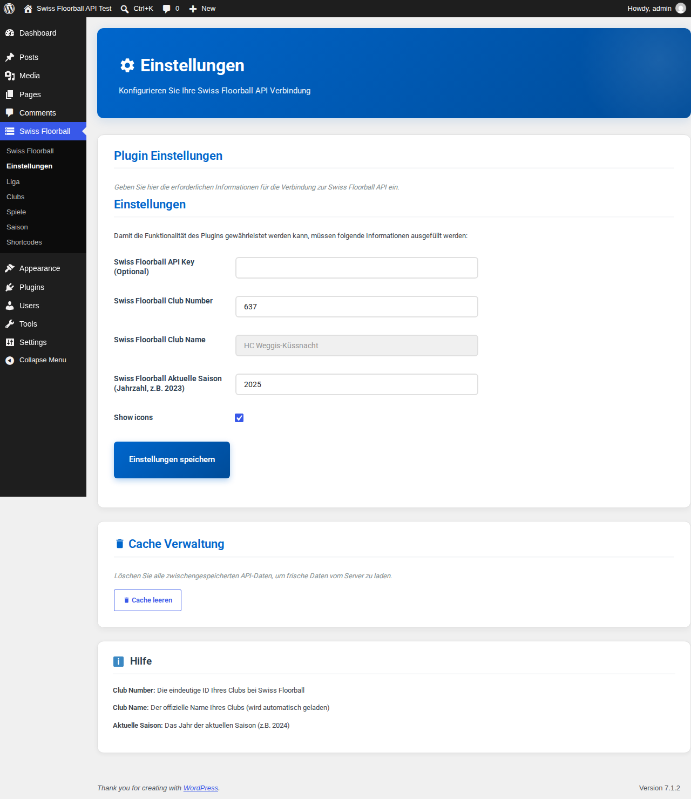
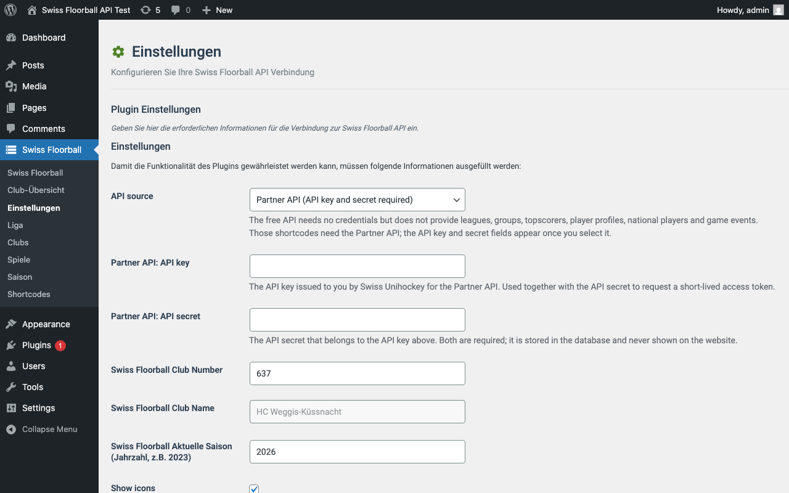
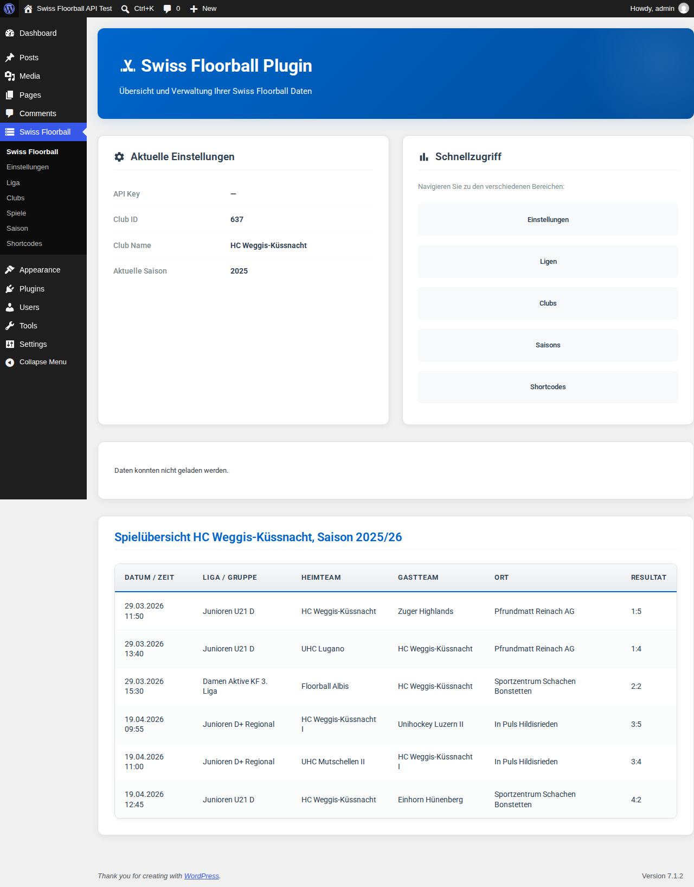
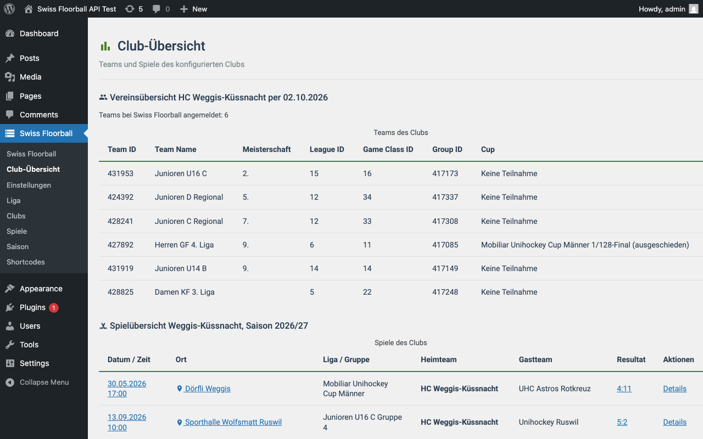
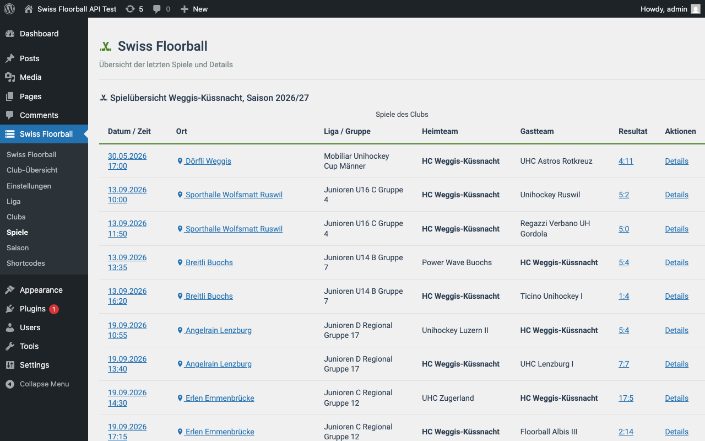
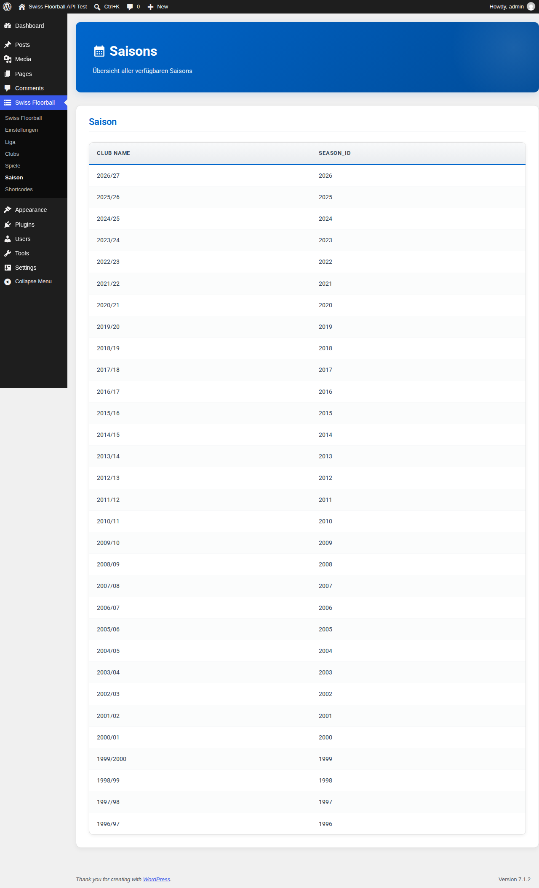
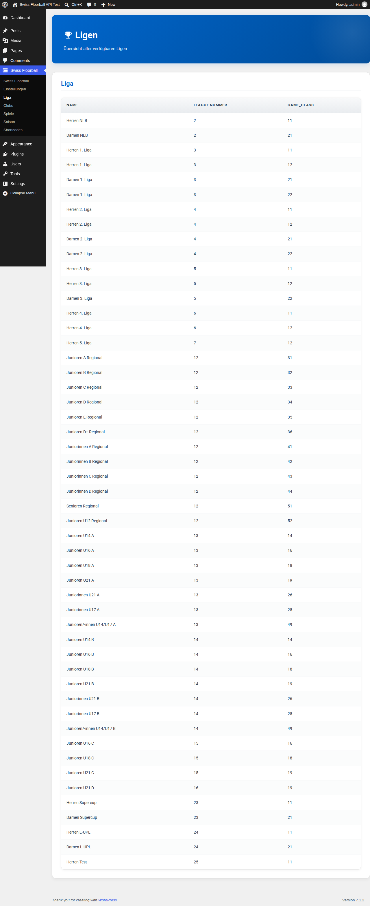
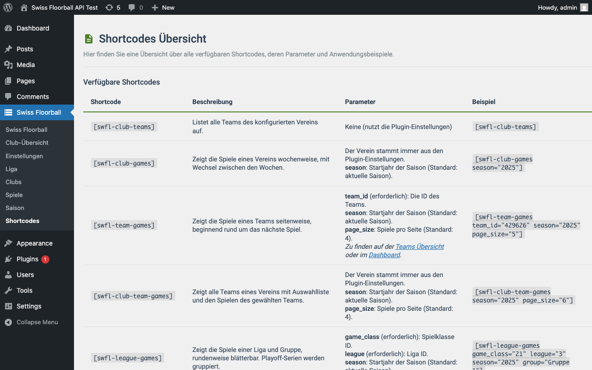

# Administration

Das Menü «Swiss Floorball» (Capability `manage_options`, Menüposition 26) wird in `admin/class-swfl-admin.php` (`addPluginAdminMenu()`) angelegt.

## Einstellungen

Untermenü «Einstellungen» (Gruppe `swfl_general_settings`). Gespeichert als WordPress-Optionen:

| Option | Bedeutung | Bereinigung |
|---|---|---|
| `swfl_club_number` | Club-Nummer (ID) | `absint`; bei Änderung wird der API-Cache geleert und der Club-Name automatisch geholt |
| `swfl_club_name` | Club-Name, nur Anzeige (wird automatisch gesetzt) | – |
| `swfl_actual_season` | Aktuelle Saison als Jahreszahl, z. B. `2025` | `absint` |
| `swfl_show_icons` | Icons anzeigen (Standard `1`) | `'1'` oder `'0'` |
| `swfl_request_timeout` | API-Timeout in Sekunden (1–30, Standard `3`) | `absint`, begrenzt auf 1–30; 0/ungültig → `3` |
| `swfl_rest_rate_limit` | Öffentliche REST-Anfragen pro Minute und Besucher (0–1000, Standard `60`, `0` = aus). Besucher werden nach IP-Adresse unterschieden, IPv6 nach dem /64-Präfix | `absint`, begrenzt auf 0–1000; ungültig → `60` |
| `swfl_upstream_budget` | Seitenweites Limit für ungecachte API-Anfragen, die öffentliche REST-Routen pro Minute auslösen dürfen (0–10000, Standard `120`, `0` = aus); jede Seite einer langen Liste zählt. Ist es aufgebraucht, antworten die Routen mit einer abgelaufenen Kopie oder mit `503` und `Retry-After`. Shortcode-Seiten, Admin, Administratoren und Warm-up zählen nicht | `absint`, begrenzt auf 0–10000; ungültig → `120` |
| `swfl_upstream_visitor_budget` | Anteil dieses Limits, den ein Besucher (IP-Adresse, IPv6-/64-Präfix) pro Minute nutzen darf (0–10000, Standard `20`, `0` = aus). So können ein oder zwei Adressen das Limit nicht für alle aufbrauchen; darüber gibt es eine abgelaufene Kopie oder `429` mit `Retry-After` | `absint`, begrenzt auf 0–10000; ungültig → `20` |
| `swfl_trusted_proxies` | Vertrauenswürdige Proxys: eine IP-Adresse oder ein CIDR-Bereich pro Zeile (IPv4 ab /8, IPv6 ab /16). Nur für Anfragen von diesen Adressen liest das Rate-Limit den Besucher aus `X-Forwarded-For`; leer = Header werden ignoriert | Normalisiert, Duplikate entfernt, höchstens 100 Einträge; ungültige Einträge werden verworfen und gemeldet |
| `swfl_cache_ttl_games` | Cache-Dauer der Spiele in Sekunden (30–86400, Standard `3600`) | `absint`, begrenzt auf 30–86400; ungültig → Standard |
| `swfl_cache_ttl_rankings` | Cache-Dauer der Ranglisten (30–86400, Standard `7200`) | wie oben |
| `swfl_cache_ttl_game_events` | Cache-Dauer der Spiel-Events (30–86400, Standard `120`, nahezu live) | wie oben |
| `swfl_cache_ttl_topscorers` | Cache-Dauer der Topscorer (30–86400, Standard `7200`) | wie oben |
| `swfl_cache_ttl_{leagues,seasons,clubs,cups,groups,teams,players,national_players}` | Cache-Dauer je weiterem Endpunkt (30–86400, Standard `3600`) | wie oben |
| `swfl_cache_interval` | Cache-Warm-up: Intervall in Minuten (0–1440, Standard `30`, `0` = aus). Ein WP-Cron-Job (`swfl_cache_warmup`) lädt Spiele, Ranglisten und Topscorer des Clubs im Hintergrund neu | `absint`, begrenzt auf 0–1440; ungültig → `30`; plant das Cron-Ereignis neu |
| `swfl_warmup_after_clear` | Nach dem manuellen «Cache leeren» sofort ein Warm-up im Hintergrund starten (Standard `0`) | `'1'` oder `'0'` |
| `swfl_api_source` | API-Quelle: `free` (Standard) oder `partner` | nur diese zwei Werte, sonst `free`; leert das Auth-Token |
| `swfl_api_key` | Partner-API: API-Key | `sanitize_text_field`; leert das Auth-Token |
| `swfl_api_secret` | Partner-API: API-Secret (Passwortfeld) | nur Steuerzeichen und umgebende Leerzeichen entfernt (`sanitize_text_field` würde gültige Zeichen verändern); leert das Auth-Token |
| `swfl_theme` | `auto` (Standard), `light`, `dark` | Whitelist |
| `swfl_seed_color` | Markenfarbe (Hex), leer = Standardfarben | Hex-Prüfung |
| `swfl_table_style` | `flat` (Standard) oder `classic` | Whitelist |
| `swfl_table_striped` | Zebra-Streifen (Standard aus) | `'1'` oder `'0'` |
| `swfl_table_{accent,header,divider,highlight}_color` | Tabellenfarben (Farbwähler) | Hex-Prüfung |

### API-Quelle und Partner-Zugangsdaten

Die Felder «Partner API: API key» und «Partner API: API secret» sind nur sichtbar, solange «API source» auf **Partner API** steht (JavaScript, `admin/js/…-admin.js`). Beide Felder sind Pflicht und werden zusammen verwendet: Das Plugin tauscht sie gegen ein kurzlebiges Auth-Token. Bei der **Free API** werden sie nicht verwendet und bleiben beim Speichern erhalten. Welche Funktionen nur mit der Partner-API laufen, steht in [Umstieg auf 2.0.0](migration.md#1-wechsel-der-api-quelle).

### Cache leeren

Auf der Einstellungsseite löst ein Formular `admin_post_swfl_clear_cache` aus (Nonce `swfl_clear_cache_action`, Capability `manage_options`). Es löscht alle Transients `swfl_*` und leitet mit Hinweis zurück. Dazu gehören auch die kurz gemerkten Fehler, die abgelaufenen Kopien und die Liste der blockierten Besucher. Die Zähler von Rate-Limit und Budget (`swfl_count_*`) bleiben und laufen mit ihrer Minute ab.

### Hinweis «Limit … erreicht»

Ist das seitenweite Limit «Upstream requests per minute» aufgebraucht, zeigt die Einstellungsseite 24 Stunden lang einen Hinweis, wann das war. Nach einer Änderung des Limits verschwindet er. Wer protokollieren oder alarmieren will, hängt sich an die Action `swfl_upstream_budget_exceeded` ([Entwicklung](developer.md)). War es normaler Besucherverkehr, den Wert erhöhen.

### Blockierte Besucher

Die Einstellungsseite listet, welche Besucher das REST-Rate-Limit oder ihr Anteil am Upstream-Limit in der letzten Stunde blockiert hat (`SWFL_Rate_Limit_Log`, Transient `swfl_rate_limited`): IPv4-Adresse bzw. IPv6-/64-Präfix, ob die Sperre noch läuft (sie endet mit der laufenden Minute), wie viele Minuten der Besucher gesperrt war und wann zum ersten Mal. Pro Besucher wird höchstens einmal pro Minute geschrieben, die Liste fasst höchstens 50 Einträge, und ein Eintrag verschwindet eine Stunde nach seiner letzten Sperre. «Cache leeren» leert auch diese Liste. Steht dort eine einzige Adresse mit vielen Minuten, die zu einem Proxy, CDN oder Firmennetz gehört, teilen sich wahrscheinlich viele Besucher diese Adresse: Proxy unter «Trusted proxies» eintragen oder das Limit erhöhen.

### Vertrauenswürdige Proxys

Hinter einem Reverse-Proxy oder CDN (z. B. Cloudflare), das die echte Besucheradresse nicht an den Webserver weitergibt, teilen sich alle Besucher die Adresse des Proxys und damit ein Rate-Limit. Besser ist, die echte Adresse im Webserver wiederherzustellen (`mod_remoteip`, nginx `real_ip_header`). Geht das nicht, die Adressbereiche des Proxys unter «Trusted proxies» eintragen, z. B. die [IP-Bereiche von Cloudflare](https://www.cloudflare.com/ips/). Das Plugin liest dann für Anfragen von diesen Adressen den Besucher aus `X-Forwarded-For` (von rechts, vertrauenswürdige Hops werden übersprungen). `CF-Connecting-IP` wird absichtlich nicht gelesen. Ungültige Einträge werden beim automatischen Speichern verworfen und im Status unter dem Formular gemeldet.

## Helper-Seiten

| Seite | Zweck |
|---|---|
| Dashboard | Kennzahlen (Club, Club-ID, Saison, API-Quelle) und Kachelnavigation |
| Club-Übersicht | Teams des Clubs und Clubspiele |
| Liga | Ligen (`leagues`) mit IDs für `league` und `game_class` (nur Partner-API) |
| Clubs | Clubs (`clubs`) mit Club-IDs |
| Spiele | Spiele des Clubs; Klick auf ein Spiel zeigt Details und Ereignisse (`match_id`) und liefert die Spiel-ID |
| Saison | Saisons (`seasons`) für `season` |
| Shortcodes | Übersicht der Shortcodes |

Beispiele der Helper-Seiten:

Die Seiten nutzen dieselben `SWFL_Display::render_*`-Methoden wie die Shortcodes (siehe [Architektur](architecture.md)).

## IDs finden

- **Club-ID:** Seite «Clubs».
- **Saison:** Seite «Saison» (Jahreszahl).
- **Liga / Spielklasse (`league`, `game_class`):** Seite «Liga».
- **Gruppe:** Shortcode [`swfl-groups`](shortcodes.md#swfl-groups) mit Liga und Spielklasse (nur Partner-API). Für `swfl-rankings` und `swfl-league-games` den Gruppennamen verwenden, z. B. `Gruppe 1`.
- **Team-ID:** Shortcode `swfl-club-teams` bzw. Seite «Clubs».
- **Spiel-ID:** Seite «Spiele».

Weiter: [Fehlerbehebung](troubleshooting.md).
